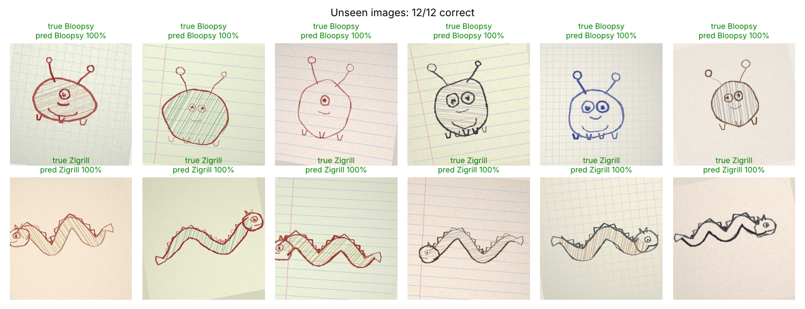
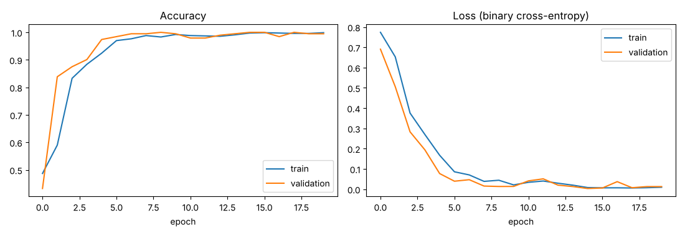

# CNN Binary Classification: Bloopsy vs Zigrill

**Deep Learning Application, Project #1 (Individual)**
SOFIR SAKIF BIN · 24930038 · Dept. of AI & Computer Engineering, Tongmyong University

This is a binary image-classification CNN built with Keras and TensorFlow.
Instead of masks, it tells apart **two invented animals**, drawn as sketchbook doodles in pen, pencil and coloured pencil on lined, grid and plain paper. No images come from the internet.

> The drawings were made with AI assistance, not by hand.

| Label | Species | What it looks like |
|---|---|---|
| 0 | **Bloopsy** | round, puffy body · two antennae with little balls · 1 to 3 big eyes · stubby legs · smile |
| 1 | **Zigrill** | long wavy serpent · spikes along its back · horns · one eye · forked tail |

Both species use the same pens, colours and paper types, so the network has to learn **body shape**, not colour.



## Results

| Check | Data | Result |
|---|---|---|
| Test split | 240 augmented images | **99.17%** accuracy, loss 0.0172 (2 errors) |
| Unseen drawings | 12 new images, never used in training or augmentation | **12 / 12 correct** |



**Honest limits.** The test split is taken after augmentation, so copies of the same original drawing can appear in both train and test, which makes that score optimistic. The 12 unseen drawings are the fairer test. Also, the two species have very different body shapes, so this is an easy task. Real photos of similar-looking animals would be much harder.

## Project steps (as instructed)

| Step | File | What it does |
|---|---|---|
| 1. Get your own images | `origin/0`, `origin/1`, `predict/` | 20 drawings per class for training, plus 12 separate drawings kept aside for testing |
| 2. Augmentation | `1_Image_Generator_Augmentation.ipynb` | `ImageDataGenerator`: 30 copies per image with rotation, zoom, shift, flip and brightness (seeded, so results repeat) → about 1,200 images in `aug/` |
| 3. Training | `2_Fit_Binary_CNN.ipynb` | Train/val/test split, CNN, 20 epochs, saves `model_trained_data.h5` |
| 4. Testing & Prediction | `3_Predict.ipynb` | Loads the model and predicts every image in `predict/` |

## Model

```
Input 128×128×3
Conv2D(32,3×3,relu) → MaxPool
Conv2D(64,3×3,relu) → MaxPool → Dropout(0.25)
Conv2D(64,3×3,relu) → MaxPool → Dropout(0.25)   ← third block
Flatten → Dense(128,relu) → Dropout(0.5) → Dense(1,sigmoid)
loss = binary_crossentropy · optimizer = adam · 1,662,209 params
```

**Why a third Conv block:** with only two blocks, `Flatten` outputs 30×30×64 = 57,600 values, so the first Dense layer alone has about 7.4M weights (a ~30 MB file). Adding the block reduces this to 14×14×64 = 12,544 values, so the whole model has about 1.66M parameters (6.4 MB). It trains faster and overfits less.

## How to run

Open Jupyter, then run notebooks **1 → 2 → 3** in order (Kernel → Restart & Run All).
Each notebook's first code cell installs anything missing (TensorFlow, OpenCV, scikit-learn, matplotlib, Pillow), so no manual setup is needed.
Or install manually with `pip install -r requirements.txt`.

`aug/` is not uploaded because notebook 1 regenerates it. All paths are relative, so the project runs from this folder on any computer.
